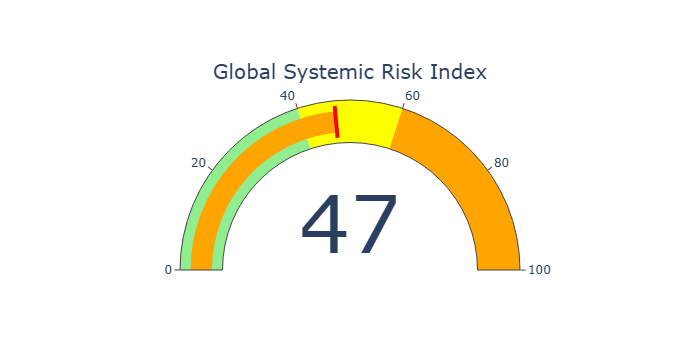
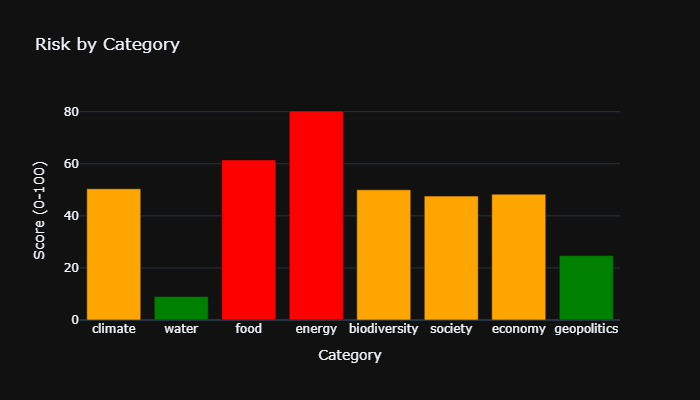
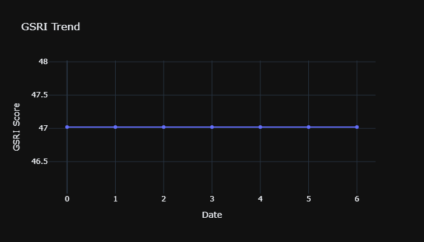
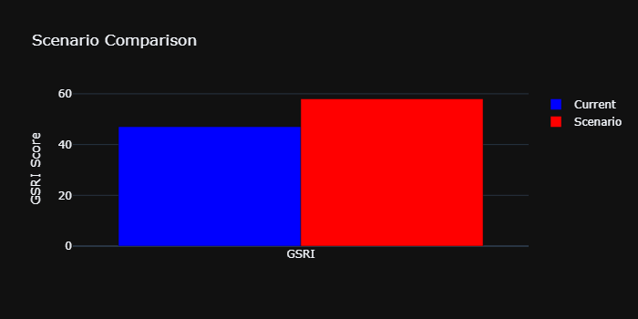
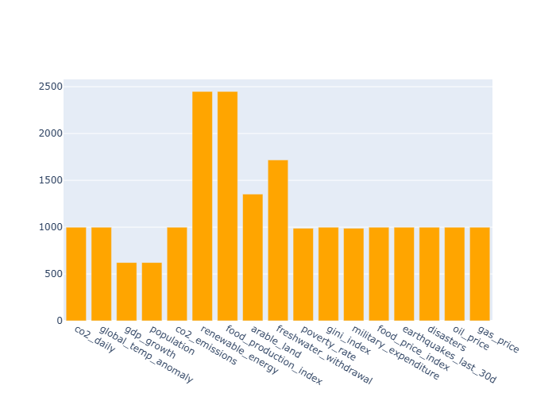
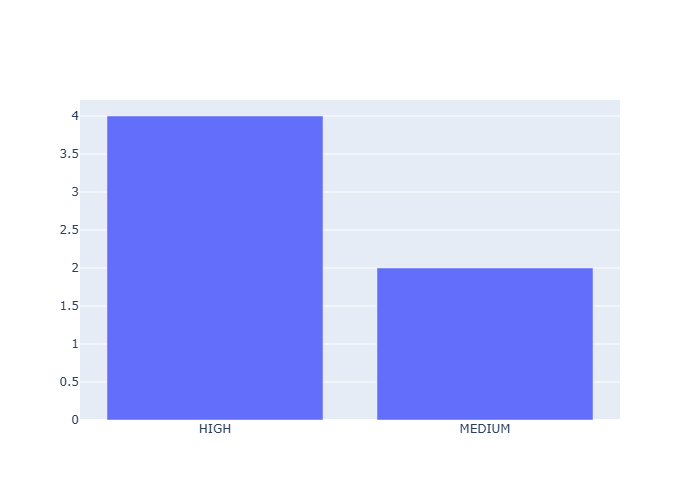

# 🌍 Global Systemic Risk Intelligence (GSRI)

[](https://www.python.org/)
[](https://streamlit.io/)
[](https://plotly.com/)
[](https://pandas.pydata.org/)
[](https://scikit-learn.org/)
[](LICENSE)

A production-quality **real-time global systemic risk monitoring platform** that continuously ingests public data from authoritative sources, calculates a Global Systemic Risk Index (GSRI) with four weighting methodologies, and surfaces interactive insights through a live Streamlit dashboard.

---

## 📊 Dashboard

| GSRI Gauge | Category Risk Breakdown |
|---|---|
|  |  |

| Trend & Momentum | Scenario Simulator |
|---|---|
|  |  |

| Data Freshness Monitor | Active Alerts |
|---|---|
|  |  |

---

## 🗂 Project Structure

```
gsri/
├── data/
│   └── gsri.db                    # SQLite database (auto-created on first run)
├── notebooks/                     # Exploratory analysis (optional)
├── src/
│   ├── __init__.py
│   ├── __main__.py               # CLI entry point: python -m src [cmd]
│   ├── config.py                 # All data sources, indicators, bounds, weights
│   ├── database.py               # SQLite schema & CRUD helpers
│   ├── data_ingestion.py         # API fetch + validation (NOAA, WB, USGS, FAO, etc.)
│   ├── risk_calculator.py        # Normalisation, GSRI (4 methods), momentum, compound risk
│   ├── alerts.py                 # Early warning system with cooldown & severity
│   ├── forecasting.py            # ARIMA / RF future GSRI forecasts
│   └── visualizations.py         # Plotly chart helpers (gauge, bars, maps, etc.)
├── dashboard.py                  # Streamlit UI (run: streamlit run dashboard.py)
├── requirements.txt              # Python dependencies
├── README.md                     # This file
└── LICENSE                       # MIT License
```

---

## ⚡ Quick Start

```bash
# Clone (keep private until ready)
git clone https://github.com/dawson-efraim/gsri.git
cd gsri

# Create venv & install
python -m venv .venv
source .venv/bin/activate          # Windows: .venv\Scripts\activate
pip install -r requirements.txt

# Run the full pipeline once (fetch → calc → alerts)
python -m src all

# Launch interactive dashboard (auto-refreshes every 5 min)
streamlit run dashboard.py
```

**CLI Commands**
| Command | Action |
|---------|--------|
| `python -m src ingest` | Pull latest data from all sources, store in SQLite |
| `python -m src risk` | Compute GSRI (all 4 weighting methods) + momentum |
| `python -m src alerts` | Evaluate thresholds, list active alerts |
| `python -m src forecast` | Produce 7-day GSRI forecast (ARIMA default) |
| `python -m src all` | Run ingest → risk → alerts in one step |

No external API keys, Kaggle accounts, or manual downloads required — all sources are public and the SQLite DB builds itself on first run.

---

## 🔧 Features

- **Automated multi-source ingestion** — NOAA CO₂ (daily), World Bank (annual), USGS earthquakes (daily), FAO food prices (monthly), commodity APIs (hourly)
- **Data validation & freshness tracking** — ±20% bounds check, duplicate detection, stale-data warnings, last-valid-observation fallback
- **Global Systemic Risk Index (GSRI)** — 0–100 scale with **four weighting methods**: Expert (theory), Equal, Statistical (inverse variance), PCA (first component loadings)
- **Momentum analysis** — 7/30/90-day GSRI change with labels: *Rapidly Improving → Rapidly Deteriorating*
- **Compound risk detection** — flags ≥3 simultaneously elevated categories, suggests cascade pathways (e.g., Climate → Water → Food → Economy)
- **Early warning alerts** — configurable GSRI/categorical/momentum/compound thresholds with confidence scores & 72h cooldown
- **Time-series forecasting** — ARIMA(5,1,0) + Random Forest trend models for 7–30 day GSRI outlook
- **Scenario simulator** — interactive sliders (±% per domain) → projected GSRI with driver breakdown
- **World risk map** — choropleth by country/region (placeholder; extendable with geopandas)
- **Full auditability** — every calculation stores timestamp, data/model version, raw indicator values, weights, and method

---

## 📈 Questions Answered

| # | Question | Dashboard View |
|---|---|---|
| 1 | **What is the current global systemic risk level?** | GSRI Gauge (0–100, colour-coded) |
| 2 | **Which domains are driving risk right now?** | Category Breakdown bar chart |
| 3 | **Is risk accelerating or decelerating?** | Momentum chart + 30d label |
| 4 | **Are multiple systems failing together?** | Compound risk alerts + cascade hints |
| 5 | **How fresh is the underlying data?** | Data Freshness table (age per indicator) |
| 6 | **What could GSRI look like under stress?** | Scenario Simulator (±% sliders) |
| 7 | **Where is risk concentrated geographically?** | World Risk Map (choropleth) |

### Current Sample Output (from live run)

| Metric | Value |
|---|---|
| **GSRI (Expert)** | **47.0 / 100** — MODERATE |
| **GSRI (Equal)** | 46.5 |
| **GSRI (Statistical)** | 9.7 |
| **GSRI (PCA)** | 49.0 |
| **30-day Momentum** | 0.0 pts → **Stable** |
| **Top Risk Categories** | Energy (80.3), Food (61.5), Climate (50.4) |
| **Active Alerts** | Energy HIGH, Food MEDIUM, Compound HIGH (8 cats elevated) |

---

## 🛠 Tech Stack

| Layer | Tools |
|---|---|
| **Orchestration / CLI** | Python 3.14, argparse |
| **Data Ingestion** | requests, pandas, urllib |
| **Storage** | SQLite (zero-config, file-based) |
| **Analytics / ML** | pandas, NumPy, scikit-learn (PCA, RandomForest), statsmodels (ARIMA) |
| **Visualisation** | Plotly (interactive), Streamlit (web UI) |
| **Scheduling (planned)** | GitHub Actions / APScheduler / cron |
| **Containerisation (planned)** | Docker + docker-compose |

---

## 📂 Data Sources

| Source | Indicators | Frequency | Notes |
|---|---|---|---|
| **NOAA GML** | CO₂ daily (Mauna Loa) | Daily | Authoritative atmospheric record |
| **NOAA NCEI** | Global temperature anomaly | Monthly | Land-ocean combined |
| **World Bank** | GDP growth, population, CO₂ emissions, renewable %, food production, arable land, freshwater withdrawal, poverty, Gini, military expenditure | Annual | Country-level, global aggregate (WLD) |
| **FAO** | Food Price Index | Monthly | 2014–2016 = 100 base |
| **USGS** | Earthquakes M2.5+ (30-day) | Daily | Real-time GeoJSON feed |
| **Commodity APIs** | WTI crude, Henry Hub gas | Hourly | Market prices via public endpoints |

**Limitations / Interpretation caution**
- Coverage is ~20 indicators across 8 categories — many systems (biodiversity, extreme weather, nuclear risk) are proxied or absent.
- Statistical/PCA weights depend on available history; short series → unstable weights.
- World Bank data is annual; freshness lag can be 12–24 months.
- GSRI is a **relative risk monitor**, not a probability of extinction. Treat scores as directional signals for prioritisation, not absolute forecasts.
- All findings reflect the data-generating processes of public agencies; correlations ≠ causation without further analysis.

---

## 🔬 Methodology Snapshot

1. **Normalise** each indicator to 0–100 (higher = more risk; direction handled per indicator).
2. **Average** by category → 8 category scores.
3. **Weight & aggregate** → GSRI via 4 methods (Expert default).
4. **Momentum** = GSRI change over rolling windows; classify trend.
5. **Compound check** = simultaneous category elevations ≥ threshold.
6. **Alert** = threshold breaches with severity + confidence.
7. **Forecast** = ARIMA on daily GSRI series; RF as alternative.
8. **Scenario** = user-defined % deltas × expert weights → projected GSRI.

All steps reproducible: every run writes a timestamped row to `risk_calculations` with full weight JSON and method tag.

---

## 🚀 Roadmap (v1 → v2)

- [ ] Add biodiversity, climate-extreme, and socio-political indicators
- [ ] Hourly GitHub Actions scheduler for true real-time updates
- [ ] Docker + Postgres for multi-user / production deployment
- [ ] CI/CD with automated ingestion & calculation tests
- [ ] Ensemble forecasting (LSTM, Prophet) with uncertainty bands
- [ ] User auth + per-user alert subscriptions
- [ ] Interactive choropleth with real country-level data

---

*Built as a portfolio-grade data-science system — raw data → live risk intelligence.*

---

## 📄 License

MIT License — see `LICENSE` for details.